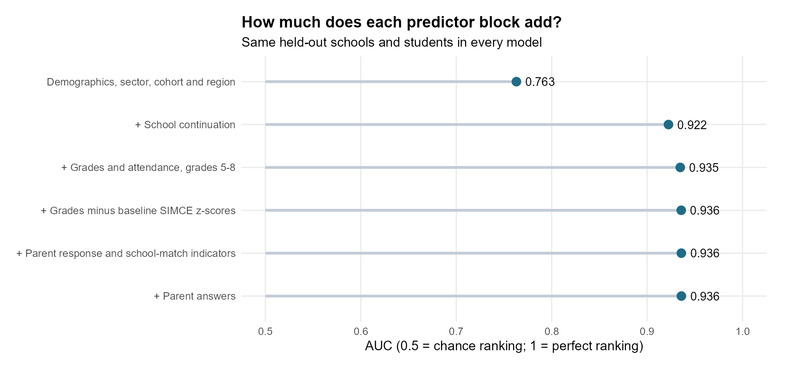

# Predicting grade-8 SAE participation

Primary classification benchmark: [Can we beat the continuation rule?](continuation_benchmark.md). This compares accuracy and mistakes corrected against predicting no application wherever grade 9 is offered.

The analysis includes 660,426 students in the 2017-2020 grade-8 cohorts within SAE-covered origin regions. The fixed school split assigns 527,933 students to training and 132,493 to testing.

Adding grades, attendance, SIMCE comparisons and parent information to school continuation reduces held-out Brier error by 4.9% (0.0857 to 0.0815).

Parent answer content changes Brier error from 0.0816 to 0.0815, after holding questionnaire response/matching information constant. This is a 0.04% relative reduction.

Excluding grade-8 annual grades, attendance and SIMCE gaps gives AUC 0.934 and Brier 0.0835.

## Application rates by school continuation

| School continuation | Students | Application rate |
| --- | --- | --- |
| Ends at 8 in SAE offerings | 287,101 | 95.7% |
| Offers grade 9 | 313,813 | 14.6% |
| Not resolved in SAE offerings | 59,367 | 8.2% |
| Other SAE offering | 145 | 91.0% |

## Held-out prediction

| Model | AUC | Brier | Brier R2 | Log loss |
| --- | --- | --- | --- | --- |
| Demographics, sector, cohort and region | 0.76304 | 0.193949 | 0.2246 | 0.571182 |
| + School continuation | 0.92238 | 0.085700 | 0.6574 | 0.302089 |
| + Grades and attendance, grades 5-8 | 0.93473 | 0.081929 | 0.6724 | 0.287439 |
| + Grades minus baseline SIMCE z-scores | 0.93574 | 0.081648 | 0.6736 | 0.286362 |
| + Parent response and school-match indicators | 0.93587 | 0.081575 | 0.6739 | 0.286119 |
| + Parent answers | 0.93591 | 0.081542 | 0.6740 | 0.285987 |
| Full model excluding grade 8 annual measures | 0.93369 | 0.083497 | 0.6662 | 0.291552 |

## Performance within school groups

| Group | Model | N | AUC | Brier |
| --- | --- | --- | --- | --- |
| Offers grade 9 | + School continuation | 62,189 | 0.583 | 0.1296 |
| Not resolved in SAE offerings | + School continuation | 11,531 | 0.663 | 0.0662 |
| Ends at 8 in SAE offerings | + School continuation | 58,754 | 0.612 | 0.0431 |
| Other SAE offering | + School continuation | 19 |  | 0.0062 |
| Offers grade 9 | + Grades minus baseline SIMCE z-scores | 62,189 | 0.646 | 0.1263 |
| Not resolved in SAE offerings | + Grades minus baseline SIMCE z-scores | 11,531 | 0.721 | 0.0654 |
| Ends at 8 in SAE offerings | + Grades minus baseline SIMCE z-scores | 58,754 | 0.777 | 0.0376 |
| Other SAE offering | + Grades minus baseline SIMCE z-scores | 19 |  | 0.0033 |
| Offers grade 9 | + Parent answers | 62,189 | 0.646 | 0.1261 |
| Not resolved in SAE offerings | + Parent answers | 11,531 | 0.716 | 0.0656 |
| Ends at 8 in SAE offerings | + Parent answers | 58,754 | 0.780 | 0.0375 |
| Other SAE offering | + Parent answers | 19 |  | 0.0034 |

## Full model by cohort

| Cohort | N | AUC | Brier | Observed rate | Predicted rate |
| --- | --- | --- | --- | --- | --- |
| 2017 | 8,454 | 0.918 | 0.1051 | 0.509 | 0.497 |
| 2018 | 28,887 | 0.939 | 0.0832 | 0.542 | 0.545 |
| 2019 | 47,083 | 0.929 | 0.0880 | 0.499 | 0.499 |
| 2020 | 48,069 | 0.942 | 0.0701 | 0.480 | 0.478 |

## Increment from parent answer content by group

| Group | Brier without answer content | Brier with answer content | Reduction x1000 |
| --- | --- | --- | --- |
| Cohort 2017 | 0.105273 | 0.105135 | 0.139 |
| Cohort 2018 | 0.083284 | 0.083158 | 0.126 |
| Cohort 2019 | 0.087964 | 0.087988 | -0.024 |
| Cohort 2020 | 0.070123 | 0.070107 | 0.016 |
| Different grade-4 and grade-8 school | 0.091087 | 0.091143 | -0.056 |
| Same grade-4 and grade-8 school | 0.072873 | 0.072792 | 0.080 |

## Parent questions with greatest held-out model reliance

| Question | Observed test answers | Log-odds / SD | Clustered SE | Held-out log-loss increase x1000 |
| --- | --- | --- | --- | --- |
| Students level of learning | 58,798 | -0.071 | 0.012 | 0.208 |
| Values formation | 67,316 | -0.058 | 0.012 | 0.120 |
| Communication of school values | 91,842 | -0.048 | 0.012 | 0.107 |
| Teachers encourage students to help one another | 67,249 | 0.058 | 0.012 | 0.100 |
| Work with students with behavior problems | 99,422 | 0.047 | 0.010 | 0.093 |
| School motivates interest in learning | 58,268 | 0.048 | 0.013 | 0.058 |
| School discipline and compliance with rules rating | 99,597 | -0.032 | 0.010 | 0.052 |
| Child feels protected with peers (2014-15) | 59,140 | -0.043 | 0.010 | 0.040 |
| Would enroll child here again | 32,817 | -0.028 | 0.022 | 0.039 |
| Child feels accepted by teachers (2013) | 8,640 | -0.060 | 0.027 | 0.032 |
| Students commitment to school | 67,024 | -0.022 | 0.010 | 0.031 |
| Quality of teaching (2014) | 23,667 | 0.059 | 0.018 | 0.013 |

## Interpretation and construction

- Primary outcome: at least one explicit grade-9 application in regular or complementary SAE rounds in the grade-8 cohort year. Automatically appended continuity rows do not establish a choice. Off-platform/regularization activity is not measured.
- School continuation uses that process's A1 offerings. An observed grade-8 origin with no secondary offering is the ends-at-8 group. Early rollout menus omit some nonentry grades. Schools absent from A1 are unresolved, not assumed terminal. The 2018 Nuble boundary change is harmonized for coverage.
- The main exercise is retrospective: annual grade-8 performance and attendance can postdate application. The model excluding those measures still uses annual origin-school records, so it is not a validated application-date forecast.
- Grades, attendance and their peer-relative z-scores enter separately for grades 5-8, with squares. Math and language gaps equal grade z-score minus the baseline SIMCE z-score among the same later schoolmates. These are relative positions, not learning gains. SIMCE first uses national test-year normalization. Undefined peer SDs remain missing.
- All model comparisons use identical pupils and a fixed 80/20 split by grade-8 origin school across cohorts. Median imputation and predictor scaling use training data only. Context controls are cohort-by-region, sector, gender and age. Schools with missing continuation information remain in the model.
- The 39 parent questions/constructs were chosen from the source questionnaires before estimating outcome associations. They describe the grade-4 school. Wording and availability vary by year; exact codes and wording are saved in the parent dictionary. Higher valid ratings are favorable; the 2013 agreement scale and 2016 mistreatment response are reversed.
- The parent table ranks model reliance: average increase in test log loss when one observed answer is shuffled within survey-year, continuation and school-match strata (10 repetitions). This is exploratory held-out permutation importance, not a unique contribution, causal effect, or significance test. Correlated questions may substitute for one another.
- Parent coefficients are jointly conditional log-odds per training-sample SD, with model-derived origin-school-clustered SEs. Full coefficients and BH-adjusted parent p-values are saved. No causal interpretation is assigned.
- All student-school histories are retained. The model selects one annual record using the project attendance/promotion hierarchy and the latest observed year for each grade. Within-year movers may have a different school at application. Missing SIMCE/questionnaire information does not exclude students. Zero attendance is retained as a valid percentage.
- Brier R2 compares squared probability error to predicting the training prevalence for everyone. Subgroup AUC is particularly important because the school-continuation distinction strongly predicts overall participation. Small Other SAE offering groups have unstable metrics.
- This is a first fixed-specification result on one held-out-school split; it does not establish stability across alternative splits, future cohorts, or functional forms. No distance/comuna analysis or separate realized-school-change model is included.

Reproducible code: `code/codex/sae_participation/`. Data and diagnostics: `data/clean/sae_participation/`.
