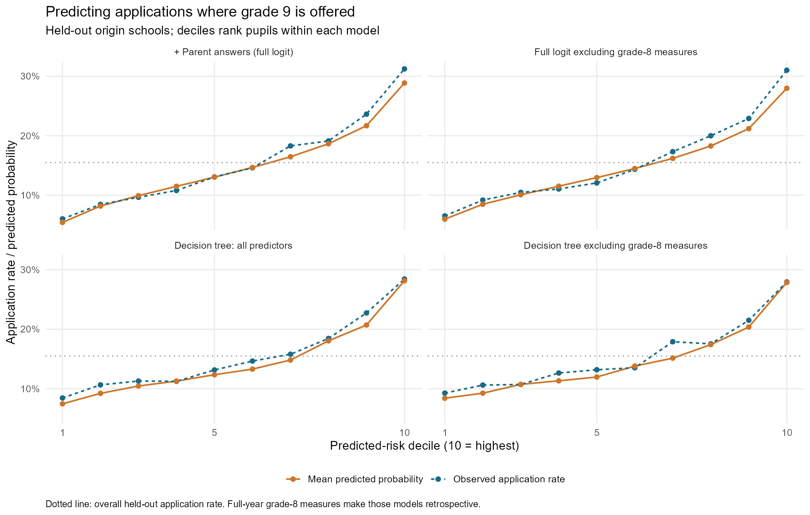

# Predicting the voluntary SAE application margin

We restrict the exercise to 313,813 students whose grade-8 origin offers grade 9. 45,947 applied through SAE (14.64%). The unchanged school split has 251,624 training and 62,189 held-out students.

Among held-out students, predicting no application for everyone is 84.518% accurate. The full logit fitted specifically on this group is 84.515% accurate, detecting 3 applicants and falsely flagging 5 nonapplicants: -2 net errors avoided. The paired accuracy difference is -0.003 percentage points (school-clustered 95% CI [-0.012, +0.006]).

Ranking is more informative than a binary cutoff: the full voluntary logit has AUC 0.657, compared with 0.646 for the earlier pooled full model. Its highest-risk 10% have an application rate of 31.2% and contain 20.2% of all held-out applicants (2.02x the overall rate).

Excluding grade-8 annual grades, attendance and gaps gives AUC 0.650, accuracy 84.515% and -2 net errors avoided. Parent answers change Brier loss from 0.12552 to 0.12542 after holding response availability and school matching constant.

The decision tree uses complexity selected within training schools. With all predictors it achieves AUC 0.623, accuracy 84.518% and 0 net errors avoided. All alternatives are shown; no model is chosen by its test accuracy.

The tree excluding grade-8 measures detects 59 applicants and falsely flags 34 nonapplicants: 25 net errors avoided and 84.558% accuracy. Its gain of +0.040 percentage points has a school-clustered 95% interval of [-0.039, +0.119], so it is small and statistically uncertain.

## Beating the no-application rule

| Model | Accuracy (%) | Applicants detected | False positives | Net errors avoided | Applicant recall (%) | Precision (%) |
| --- | --- | --- | --- | --- | --- | --- |
| Predict no application for everyone | 84.518 | 0 | 0 | 0 | 0.00 | -- |
| Previous pooled full model | 84.520 | 3 | 2 | 1 | 0.03 | 60.00 |
| Voluntary logit: context | 84.518 | 0 | 0 | 0 | 0.00 | -- |
| + Grades and attendance 5-8 | 84.515 | 0 | 2 | -2 | 0.00 | 0.00 |
| + SIMCE-relative gaps | 84.513 | 1 | 4 | -3 | 0.01 | 20.00 |
| + Parent availability and school match | 84.515 | 1 | 3 | -2 | 0.01 | 25.00 |
| + Parent answers (full logit) | 84.515 | 3 | 5 | -2 | 0.03 | 37.50 |
| Full logit excluding grade-8 measures | 84.515 | 1 | 3 | -2 | 0.01 | 25.00 |
| Decision tree: all predictors | 84.518 | 0 | 0 | 0 | 0.00 | -- |
| Decision tree excluding grade-8 measures | 84.558 | 59 | 34 | 25 | 0.61 | 63.44 |

## Probability prediction and identifying likely applicants

| Model | AUC | Average precision | Brier | Top 10%: application rate (%) | Top 10%: share of applicants (%) | Top 10%: lift |
| --- | --- | --- | --- | --- | --- | --- |
| Training application rate | 0.500 | 0.155 | 0.13096 | -- | -- | -- |
| Previous pooled full model | 0.646 | 0.256 | 0.12609 | 31.4 | 20.3 | 2.03 |
| Voluntary logit: context | 0.589 | 0.201 | 0.12925 | 23.7 | 15.3 | 1.53 |
| + Grades and attendance 5-8 | 0.647 | 0.247 | 0.12618 | 30.5 | 19.7 | 1.97 |
| + SIMCE-relative gaps | 0.654 | 0.251 | 0.12570 | 31.1 | 20.1 | 2.01 |
| + Parent availability and school match | 0.656 | 0.254 | 0.12552 | 31.3 | 20.2 | 2.02 |
| + Parent answers (full logit) | 0.657 | 0.255 | 0.12542 | 31.2 | 20.2 | 2.02 |
| Full logit excluding grade-8 measures | 0.650 | 0.251 | 0.12586 | 31.0 | 20.0 | 2.00 |
| Decision tree: all predictors | 0.623 | 0.231 | 0.12731 | 28.4 | 18.4 | 1.84 |
| Decision tree excluding grade-8 measures | 0.615 | 0.234 | 0.12735 | 27.9 | 18.1 | 1.81 |

## Results by cohort

| Cohort | Model | Students | Application rate (%) | AUC | Accuracy gain (pp) | Net errors avoided |
| --- | --- | --- | --- | --- | --- | --- |
| 2018 | + Parent answers (full logit) | 12,762 | 16.76 | 0.675 | 0.000 | 0 |
| 2019 | + Parent answers (full logit) | 22,373 | 17.17 | 0.651 | -0.004 | -1 |
| 2020 | + Parent answers (full logit) | 22,947 | 12.28 | 0.632 | -0.004 | -1 |
| 2017 | + Parent answers (full logit) | 4,107 | 20.19 | 0.667 | 0.000 | 0 |
| 2018 | Full logit excluding grade-8 measures | 12,762 | 16.76 | 0.662 | -0.008 | -1 |
| 2019 | Full logit excluding grade-8 measures | 22,373 | 17.17 | 0.645 | -0.004 | -1 |
| 2020 | Full logit excluding grade-8 measures | 22,947 | 12.28 | 0.624 | 0.000 | 0 |
| 2017 | Full logit excluding grade-8 measures | 4,107 | 20.19 | 0.656 | 0.000 | 0 |
| 2018 | Decision tree: all predictors | 12,762 | 16.76 | 0.645 | 0.000 | 0 |
| 2019 | Decision tree: all predictors | 22,373 | 17.17 | 0.616 | 0.000 | 0 |
| 2020 | Decision tree: all predictors | 22,947 | 12.28 | 0.578 | 0.000 | 0 |
| 2017 | Decision tree: all predictors | 4,107 | 20.19 | 0.605 | 0.000 | 0 |
| 2018 | Decision tree excluding grade-8 measures | 12,762 | 16.76 | 0.617 | 0.055 | 7 |
| 2019 | Decision tree excluding grade-8 measures | 22,373 | 17.17 | 0.605 | 0.022 | 5 |
| 2020 | Decision tree excluding grade-8 measures | 22,947 | 12.28 | 0.582 | 0.000 | 0 |
| 2017 | Decision tree excluding grade-8 measures | 4,107 | 20.19 | 0.609 | 0.317 | 13 |

## Definitions and validation

- Voluntary denotes an application by a student whose current school offers grade 9 in SAE A1. It does not establish the reason for applying or an eventual school change. Unresolved and terminal origins are excluded from this exercise.
- The outcome is an explicit grade-9 application in either regular or complementary rounds in the first observed grade-8 year (2017-2020). The school split is unchanged from the earlier exercise. This follow-up uses an already-examined holdout, so it is exploratory and is not an independent confirmatory test.
- Each logit is re-estimated only within the voluntary group. Predictors and quadratic effects follow the earlier definitions. Context includes cohort-by-region, school sector, gender and age. Missingness indicators remain; medians and scaling are re-estimated from voluntary training pupils only. School continuation itself is constant and omitted.
- Classification uses a fixed 0.5 cutoff and equal error costs. Net errors avoided equals correctly detected applicants minus falsely flagged nonapplicants. A negative value is worse than predicting no application for everyone. Paired confidence intervals cluster at origin school and condition on the fitted models.
- The tree is CART regression on the binary outcome: leaf means are application probabilities and splits/pruning use squared error. Maximum depth is 8, minimum leaf size is 200, and there is no class reweighting or surrogate splitting. Complexity candidates are 0.01, 0.005, 0.001, 0.0005 and 0.0001. A 20% school split within original training chooses highest validation accuracy, then lowest Brier loss, then the simpler tree. The chosen complexity is refitted on all original training pupils. Inner imputation is learned only from inner training. Tree predictors omit redundant squared terms, which do not add information.
- AUC measures ranking. Average precision summarizes precision across recall levels with equal-score groups handled together. Top-decile counts select the 10% highest predicted probabilities; student ID breaks ties independently of outcomes. Lift divides their application rate by the overall held-out rate. Decile plots use nearly equal-sized rank groups.
- The all-nonapplicant classification benchmark and the training-rate probability benchmark have identical binary predictions. Brier loss and average precision use probabilities directly. Classification improvement is not interchangeable with better probability ranking.
- Full-year grade-8 predictors can postdate application. Models excluding them are useful sensitivities, but annual origin records still do not establish application-date enrollment. No geography, new data sources, actual-move outcome, or causal interpretation is introduced.
- Verification passed 67 checks, including same-sample school splits, convergence, saved-model reproduction, independent confusion counts and independently computed AUC. Selected tree complexity and full coefficients are saved with the analysis.

[Continuation benchmark](continuation_benchmark.md) | [Original report](report.md)
