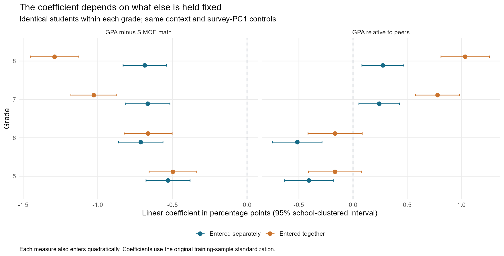

# GPA, baseline achievement and parent-survey PCA

Each separate regression includes one grade-specific measure and its square, context controls and year-specific survey PC1 scores. All use the same 313,813 voluntary-margin students and school-clustered standard errors. The joint comparison enters all six measures for all four grades together with the same controls.

For grade 8, peer-relative GPA changes from +0.313 (0.095) alone to +5.897 (0.429) jointly. The math gap changes from -0.679 (0.074) alone to -2.950 (0.468) jointly. These are coefficients on standardized regressors, in percentage points; the large joint coefficients are not standalone associations.

Survey PC1 explains 47.0-53.5% of item variation across survey years. Higher scores reflect more favorable reports. With all academic controls, one SD higher PC1 is associated with 0.67-1.24 percentage points less voluntary application across the four survey years.

PCA uses 218,241 complete questionnaires (69.5% of the regression sample). Students without a complete questionnaire remain in every full-sample regression; missing scores are set to the zero reference with explicit year-specific completeness indicators.

## Reading GPA and the math-gap coefficient

Let G be GPA standardized within school-grade-year peers, M baseline grade-4 SIMCE math relative to those peers, and D = G - M. The gap is a difference in relative positions, not a measured learning gain.

In the linear part, a*G + b*(G-M) = (a+b)*G - b*M. Holding G fixed, a larger gap means lower baseline SIMCE math. Holding the gap fixed, a higher G also means a higher baseline score. Therefore the coefficient on G in the joint gap specification is not the association with current GPA holding baseline achievement fixed.

The original regression also contains the language gap, so its linear coefficient contributes to the current-GPA re-expression too. The report below undoes each regressor SD before combining coefficients and computes SEs from the full original school-clustered covariance matrix.

Quadratic terms matter: q*(G-M)^2 expands to q*G^2 - 2*q*G*M + q*M^2. The re-expressed coefficients below are local slopes at the original centered reference values; they are not globally constant effects. The original polynomial was verified algebraically.

The full joint model also controls for absolute GPA, attendance, the language gap and the other grades. Changing peer-relative GPA while holding absolute GPA fixed also changes the peer comparison. Use the separate and same-sample pair regressions to distinguish these conditioning choices; the math-gap identity alone does not explain every difference.

## One grade-specific measure at a time

| Variable | Term | Grade 5 | Grade 6 | Grade 7 | Grade 8 |
| --- | --- | --- | --- | --- | --- |
| GPA | Linear | -1.799 (0.140) | -1.986 (0.140) | -1.339 (0.142) | -1.295 (0.138) |
| GPA | Quadratic | -0.263 (0.073) | -0.234 (0.073) | 0.025 (0.074) | -0.395 (0.047) |
| Attendance | Linear | -1.182 (0.141) | -1.315 (0.153) | -1.662 (0.209) | -2.806 (0.300) |
| Attendance | Quadratic | -0.095 (0.015) | -0.137 (0.015) | -0.174 (0.022) | -0.328 (0.044) |
| GPA relative to peers | Linear | -0.460 (0.114) | -0.544 (0.114) | 0.227 (0.091) | 0.313 (0.095) |
| GPA relative to peers | Quadratic | -0.355 (0.066) | -0.406 (0.066) | -0.158 (0.056) | -0.101 (0.049) |
| Attendance relative to peers | Linear | -0.056 (0.089) | 0.221 (0.094) | 0.463 (0.117) | -0.034 (0.137) |
| Attendance relative to peers | Quadratic | -0.108 (0.020) | -0.041 (0.019) | -0.009 (0.023) | 0.015 (0.020) |
| GPA minus baseline SIMCE math | Linear | -0.537 (0.075) | -0.715 (0.075) | -0.654 (0.075) | -0.679 (0.074) |
| GPA minus baseline SIMCE math | Quadratic | 0.091 (0.043) | 0.140 (0.047) | 0.076 (0.049) | -0.018 (0.046) |
| GPA minus baseline SIMCE language | Linear | -0.438 (0.072) | -0.569 (0.072) | -0.451 (0.071) | -0.459 (0.071) |
| GPA minus baseline SIMCE language | Quadratic | 0.066 (0.047) | 0.171 (0.049) | 0.171 (0.052) | 0.084 (0.047) |

## All academic measures together, with the same PCA controls

| Variable | Term | Grade 5 | Grade 6 | Grade 7 | Grade 8 |
| --- | --- | --- | --- | --- | --- |
| GPA | Linear | -1.962 (0.470) | -2.848 (0.470) | -1.938 (0.585) | -2.640 (0.398) |
| GPA | Quadratic | -0.301 (0.125) | -0.376 (0.130) | 0.012 (0.141) | -0.618 (0.079) |
| Attendance | Linear | -0.751 (0.252) | -0.721 (0.265) | -2.134 (0.388) | -2.537 (0.377) |
| Attendance | Quadratic | -0.083 (0.039) | -0.091 (0.039) | -0.276 (0.047) | -0.344 (0.061) |
| GPA relative to peers | Linear | -0.155 (0.446) | -0.782 (0.512) | 3.765 (0.571) | 5.897 (0.429) |
| GPA relative to peers | Quadratic | 0.252 (0.115) | -0.315 (0.125) | 0.303 (0.126) | 0.521 (0.087) |
| Attendance relative to peers | Linear | 0.557 (0.183) | 0.901 (0.189) | 1.513 (0.263) | 0.738 (0.209) |
| Attendance relative to peers | Quadratic | -0.031 (0.025) | 0.060 (0.027) | 0.111 (0.029) | 0.068 (0.025) |
| GPA minus baseline SIMCE math | Linear | 1.572 (0.377) | 0.675 (0.450) | -0.460 (0.488) | -2.950 (0.468) |
| GPA minus baseline SIMCE math | Quadratic | 0.062 (0.073) | 0.164 (0.094) | -0.116 (0.092) | -0.151 (0.074) |
| GPA minus baseline SIMCE language | Linear | 0.308 (0.407) | 1.668 (0.513) | -1.464 (0.560) | -0.988 (0.487) |
| GPA minus baseline SIMCE language | Quadratic | -0.179 (0.079) | 0.158 (0.095) | 0.059 (0.090) | 0.075 (0.074) |

## GPA versus math gap: identical students within each grade

| Grade | Students | GPA: alone | GPA: with math gap | Math gap: alone | Math gap: with GPA |
| --- | --- | --- | --- | --- | --- |
| 5 | 274,971 | -0.408 (0.115) | -0.166 (0.125) | -0.529 (0.075) | -0.497 (0.081) |
| 6 | 274,573 | -0.515 (0.117) | -0.166 (0.127) | -0.712 (0.076) | -0.663 (0.082) |
| 7 | 274,905 | 0.242 (0.096) | 0.781 (0.103) | -0.665 (0.076) | -1.027 (0.078) |
| 8 | 274,425 | 0.276 (0.099) | 1.036 (0.114) | -0.685 (0.074) | -1.290 (0.083) |

## Quadratic terms in the identical-sample comparison

| Grade | GPA squared: alone | GPA squared: joint | Math gap squared: alone | Math gap squared: joint |
| --- | --- | --- | --- | --- |
| 5 | -0.356 (0.069) | -0.419 (0.069) | 0.082 (0.043) | 0.120 (0.044) |
| 6 | -0.400 (0.069) | -0.489 (0.070) | 0.132 (0.047) | 0.184 (0.047) |
| 7 | -0.158 (0.059) | -0.255 (0.060) | 0.072 (0.049) | 0.144 (0.050) |
| 8 | -0.093 (0.054) | -0.235 (0.058) | -0.023 (0.046) | 0.127 (0.048) |

## Survey PCA coefficients

| Survey year | Items | Complete questionnaires | PC1 variance (%) | PC1: context controls | PC1: all academic controls |
| --- | --- | --- | --- | --- | --- |
| 2013 | 19 | 18,294 | 47.0 | -1.450 (0.346) | -1.129 (0.335) |
| 2014 | 29 | 49,701 | 51.7 | -1.511 (0.200) | -1.244 (0.194) |
| 2015 | 20 | 76,778 | 53.5 | -1.249 (0.164) | -1.072 (0.159) |
| 2016 | 16 | 73,468 | 48.9 | -0.851 (0.137) | -0.675 (0.135) |

## Sensitivity: first three PCs, with all academic controls

| Survey year | PC1 | PC2 | PC3 | Variance, first 3 PCs (%) |
| --- | --- | --- | --- | --- |
| 2013 | -1.143 (0.335) | -0.485 (0.312) | -0.239 (0.323) | 64.4 |
| 2014 | -1.255 (0.194) | -0.986 (0.173) | 0.989 (0.199) | 64.5 |
| 2015 | -1.079 (0.159) | -0.316 (0.140) | 0.592 (0.145) | 66.6 |
| 2016 | -0.681 (0.135) | 0.309 (0.131) | 0.016 (0.131) | 65.3 |

## Questions with the largest PC1 loadings

| Year | Question | Loading | Correlation with PC1 |
| --- | --- | --- | --- |
| 2013 | Would recommend school | 0.269 | 0.804 |
| 2013 | Values formation | 0.265 | 0.791 |
| 2013 | Teachers encourage students to help one another | 0.261 | 0.781 |
| 2013 | Would enroll child here again | 0.260 | 0.778 |
| 2013 | Work with students with behavior problems | 0.254 | 0.759 |
| 2014 | School motivates interest in learning | 0.215 | 0.834 |
| 2014 | Communication of school rules | 0.215 | 0.833 |
| 2014 | Communication of school values | 0.213 | 0.826 |
| 2014 | Quality of teaching (2014) | 0.208 | 0.804 |
| 2014 | School discipline and compliance with rules rating | 0.205 | 0.795 |
| 2015 | Communication of school rules | 0.258 | 0.843 |
| 2015 | Communication of school values | 0.256 | 0.838 |
| 2015 | School discipline and compliance with rules rating | 0.255 | 0.833 |
| 2015 | Work with students with behavior problems | 0.249 | 0.816 |
| 2015 | Teachers encourage students to help one another | 0.248 | 0.810 |
| 2016 | School discipline and compliance with rules rating | 0.299 | 0.837 |
| 2016 | Work with students with behavior problems | 0.293 | 0.821 |
| 2016 | Communication about student problems | 0.292 | 0.817 |
| 2016 | Communication of school rules | 0.291 | 0.813 |
| 2016 | Work to prevent bullying | 0.289 | 0.809 |

## Observed correlations in the pair samples

| Grade | Students | Corr(GPA, gap) | Corr(GPA, baseline math) | Corr(gap, baseline math) |
| --- | --- | --- | --- | --- |
| 5 | 274,971 | 0.433 | 0.559 | -0.505 |
| 6 | 274,573 | 0.456 | 0.523 | -0.520 |
| 7 | 274,905 | 0.481 | 0.461 | -0.556 |
| 8 | 274,425 | 0.563 | 0.358 | -0.570 |

## Original regression re-expressed in current GPA and baseline achievement

| Grade | Parameter | Coefficient (SE) |
| --- | --- | --- |
| 5 | Current peer GPA at fixed math and language baselines | 1.858 (0.449) |
| 5 | Baseline SIMCE math at fixed GPA and language | -1.808 (0.419) |
| 5 | Baseline SIMCE language at fixed GPA and math | -0.376 (0.447) |
| 6 | Current peer GPA at fixed math and language baselines | 1.586 (0.458) |
| 6 | Baseline SIMCE math at fixed GPA and language | -0.696 (0.479) |
| 6 | Baseline SIMCE language at fixed GPA and math | -1.725 (0.541) |
| 7 | Current peer GPA at fixed math and language baselines | 2.068 (0.560) |
| 7 | Baseline SIMCE math at fixed GPA and language | 0.496 (0.492) |
| 7 | Baseline SIMCE language at fixed GPA and math | 1.469 (0.561) |
| 8 | Current peer GPA at fixed math and language baselines | 2.413 (0.367) |
| 8 | Baseline SIMCE math at fixed GPA and language | 2.663 (0.420) |
| 8 | Baseline SIMCE language at fixed GPA and math | 0.892 (0.437) |

## Definitions and checks

- Sample and outcome are unchanged: students whose grade-8 school offers grade 9, with an explicit regular or complementary grade-9 SAE application as the binary outcome. Main tables keep all 313,813 students; the focused pair table restricts to observed GPA and math gap within each grade and holds that sample fixed across its three regressions.
- All regressions are OLS linear probability models with standard errors clustered by grade-8 origin school. Coefficients and SEs are in percentage points. Academic scaling and median imputation retain the original voluntary-training moments; each included academic measure has its own missingness indicator.
- Common controls: cohort-by-region, sector, gender, age and square/missingness, grade-4 versus grade-8 school match/missingness, parent-record indicator, survey year, fraction of applicable questions answered and year-specific complete-survey indicators. The new specifications use survey PCs in place of the 39 separate answer coefficients. No other academic measure enters a one-at-a-time regression.
- PCA is computed separately within each survey year on complete respondents in this voluntary sample, using all the selected items actually asked that year: 19, 29, 20 and 16 items. Each item is centered and scaled among complete respondents; PCA uses their correlation matrix. No answers are imputed for PCA and application outcomes do not enter its construction.
- PC scores have mean zero and SD one among complete respondents of that year. PC1 is oriented toward favorable answers; its loadings are all positive. Scores for incomplete or unavailable questionnaires are zero with completeness controls. Year-specific slopes avoid assuming that different yearly questionnaires measure an identical construct.
- The main specification uses PC1. A prespecified sensitivity includes PCs 1-3 separately by year; PC2 and PC3 are contrasts with year-specific meanings, not additional common satisfaction indices. Their signs are oriented so their largest absolute loading is positive. Full loadings and explained variance are saved.
- The four PC1 coefficients in the all-academic model are jointly significant: school-clustered F(4,1,999) = 26.397, p = 2.32e-21.
- Inference conditions on the estimated PCA scores; it does not incorporate loading-estimation uncertainty. Complete respondents may differ from incomplete respondents. These are conditional descriptive associations, not causal effects. Annual grade-8 measures can postdate application. Geography remains deferred.
- Verification: 51 regression checks passed, plus PCA orthogonality, eigenvector, variance and score-standardization checks for each year. The grade-8 pair clustered covariance was independently reconstructed. All pair samples and one-at-a-time formulas were checked.

[Original all-variable regression](voluntary_ols.html)
